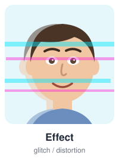
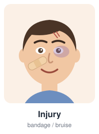
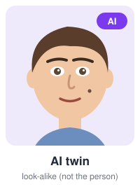

# face-robustness-bench

**How well do ArcFace and Qwen2.5-VL recognize a person in filtered, edited, low-quality and AI-generated "twin" photos?**

A benchmark that enrolls a person from clean photos and then measures, in %, how often two very different recognizers still recognize them after the face changes (filters, makeup, effects, lenses, Botox, injuries), when the photo is bad (blur, half face, other people in the frame), and whether they can tell the person apart from AI-generated look-alikes.

<table>
  <tr>
    <td></td>
    <td></td>
    <td></td>
    <td></td>
  </tr>
  <tr>
    <td></td>
    <td></td>
    <td></td>
    <td></td>
  </tr>
</table>

<sub>Illustrations only (drawn by <code>scripts/make_readme_art.py</code>). No real photos are stored in this repository.</sub>

## Pilot results

One volunteer (anonymous), 35 clean photos, 97 test photos. Full report in Turkish: [docs/BENCHMARK_RAPORU.md](docs/BENCHMARK_RAPORU.md).

| Group                                   | ArcFace               | Qwen2.5-VL            |
|-----------------------------------------|-----------------------|-----------------------|
| Changed (filter / makeup / effect)      | 100% (28/28)          | 100% (28/28)          |
| Bad (low quality / half face / crowd)   | 92.9% (52/56)         | 100% (56/56)          |
| AI twin (fake), lower = better          | 84.6% accepted (11/13) | 84.6% accepted (11/13) |

- Both models are robust to filters, makeup and effects.
- Qwen2.5-VL handles bad photos better. In crowded photos ArcFace scores the largest face, which may belong to someone else.
- Neither model can reliably reject AI-generated twins. With ArcFace, raising the threshold rejects more twins but also rejects the person's own bad photos.
- Clean held-out photos: 100% for both. Thresholds are calibrated per model at 1% false accept rate on LFW strangers.

## What it measures

| Question | Photo group | Correct outcome | Metric |
|---|---|---|---|
| Is the person still recognized after their appearance changes? | `filter`, `makeup`, `effect`, `lens`, `botox`, `injury` (or unlabeled `dirty`) | recognized | recognition % |
| Is the person recognized in bad photos? | `bad`: blur, half face, other people in the frame | recognized | recognition % |
| Can the system tell the person from a look-alike? | `twins`: AI-generated "twins" | rejected | twin accept % (lower = better) |

## How it works

```
clean photos ──split (seed 42)──► 60% gallery ──► template
                                  40% held-out ──► clean baseline

test photo ──► ArcFace:    detect + align ► 512-d embedding ► cosine to template
           └─► Qwen2.5-VL: shown next to 3 gallery photos ► "same person?" ► mean P(same)
                          │
                          ▼
           score ≥ tau (per model, calibrated at FAR 1% on LFW strangers) ► recognized
```

- **Same pairs for both models:** both see the same split, the same test photos and the same strangers, so their rates are directly comparable.
- **Twins never touch calibration:** look-alikes are scored against the template but are not used to set `tau`.
- **Nothing is dropped silently:** a photo with no detectable face, or a refused / invalid Qwen answer, counts as "not recognized" and is reported separately.
- **No leakage:** a test photo that is a byte-identical copy of a clean photo is excluded.
- **Face audit:** for every test photo, ArcFace also records how many faces were found and the best-matching face, which shows when the wrong face was picked.

## Data layout

```
data/                                         # git-ignored, never committed
├── gallery/<person_id>/*.jpg                 # clean photos (≥ 10, ideally 20-35)
├── probes/<person_id>/<category>/*.jpg       # filter | makeup | effect | lens | botox | injury | dirty | bad
├── twins/<person_id>/*.jpg                   # look-alikes (should NOT match)
└── impostors/<stranger_id>/*.jpg             # strangers for calibration (e.g. LFW)
```

## Install

```bash
python3 -m venv .venv && source .venv/bin/activate   # Python 3.11+ (developed on 3.13)
pip install -r requirements.txt
pip install .                                       # re-run after code changes
```

ArcFace weights (`buffalo_l`, ~280 MB) download on first run. For Qwen2.5-VL install [Ollama](https://ollama.com) and run `ollama pull qwen2.5vl:7b` (~6 GB).

## Quick start

```bash
# 1. Convert raw photos (HEIC/PNG/JPG -> JPEG, EXIF orientation fixed, GPS stripped) and number them
python scripts/prepare_user_data.py --person p01   # reads data/User{Main,Dirty,Bad,Fake}Photos

# 2. Strangers for threshold calibration (download and extract LFW first)
python scripts/sample_lfw_impostors.py --lfw /path/to/lfw_funneled --n 1000

# 3. Check the layout, then run both models (Qwen: ~26 s per comparison; answers are cached)
python -m frbench.cli check --data data
caffeinate -i python -m frbench.cli run --data data --backends arcface,qwen_vl --qwen-max-impostors 100

# 4. Per-photo report (Turkish, stays local). Fill docs/*_labels.csv first to group by effect.
python -m frbench.cli effects
```

## Backends

| Backend | Template | Score per test photo | Speed (CPU, M-series Mac) |
|---|---|---|---|
| `arcface` | mean of gallery embeddings | cosine similarity | < 1 s per photo |
| `qwen_vl` | the gallery photos | mean P(same) over 3 gallery photos | ~26 s per comparison |

**Qwen2.5-VL** gets one gallery photo and one test photo per query with the prompt *"Do these two photos show the same person? Ignore makeup, filters, effects and cosmetic changes. Answer JSON: {same: true/false, confidence: 0-100}."*

- **Settings:** `temperature=0` and a fixed seed. Every answer is cached on disk by image-hash pair.
- **Scoring:** a "same" answer scores `confidence/100`. A "different" answer scores `min(c, 100 - c)/100`, so it never exceeds 0.5 whether the model reports confidence as certainty or as match probability.
- **Failures:** refusals and invalid JSON become failure rows. A test photo needs 2 valid answers out of 3.

## Metrics

| Metric | Meaning |
|---|---|
| Recognition % | photos with score ≥ tau / all photos in the group, with 95% Wilson interval |
| Twin accept % | look-alikes with score ≥ tau / all look-alikes (lower = better) |
| Retention | group mean score / clean held-out mean score |
| Face score (0-100) | 0 = as similar as an average stranger, 100 = as similar as an average clean photo |
| Failures | no face found, unreadable, refusal, invalid answer, connection error |

## Privacy

Photos are personal data. Everything person-specific stays on the local machine and is git-ignored: `data/` (photos, name mapping, LFW), `results/` (scores, caches, logs), per-photo reports (`docs/HOCA_RAPORU.md`, `docs/RAPOR.md`, `docs/RESULTS.md`), the status report and the label sheets (`docs/*_labels.csv`). Only code, illustrations and aggregate numbers belong in the repository.

## Limitations

- **Pilot scale:** one person and 13-56 photos per group. Results are indicative and the confidence intervals are wide.
- **Not real twins:** the "twins" are AI edits. Some may change the face very little.
- **Calibration:** Qwen's threshold uses fewer strangers (100) than ArcFace's (1000), and Qwen's confidence values are coarse (mostly 50 or 95).
- **Scope:** results apply to the tested models only (`buffalo_l`, `qwen2.5vl:7b`).

## Development

```bash
pytest -q        # 99 tests; model tests skip if ArcFace weights are missing, Qwen tests use a mocked Ollama client
```

`docs/BUGS.md` logs every bug found and fixed. `PLAN.md` holds the original plan and test cases.

## Türkçe özet

Bu benchmark, bir kişiyi temiz fotoğraflarıyla tanıttıktan sonra ArcFace ve Qwen2.5-VL'in aynı kişinin filtreli / makyajlı / efektli, kötü çekilmiş ve yapay zekâ ile üretilmiş "ikiz" fotoğraflarını nasıl tanıdığını % olarak ölçer. Sonuçlar ve yorumlar: [docs/BENCHMARK_RAPORU.md](docs/BENCHMARK_RAPORU.md).
